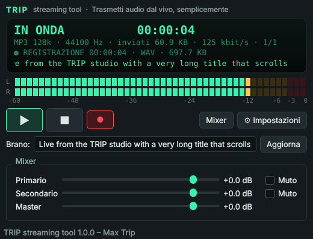

# TRIP streaming tool

**Free, lightweight, open-source live audio streaming for Windows, macOS and Linux.**
**Streaming audio dal vivo gratuito, leggero e open-source per Windows, macOS e Linux.**

Created by / Realizzato da **Massimiliano Mascioli Trippa** aka **Max Trip**.

TRIP streaming tool captures audio in real time from a microphone or sound card and sends it to
**Icecast**, **SHOUTcast** or **WebRTC/WHIP** servers. It is a full-featured clone of
BUTT (Broadcast Using This Tool), with a bilingual Italian/English interface.



[🇮🇹 Italiano](#italiano) · [🇬🇧 English](#english)

---

## Italiano

### Funzionalità

| Area | Cosa fa |
|---|---|
| **Encoder live** | Cattura l'audio in tempo reale e lo invia a una web radio o piattaforma di streaming. |
| **Server** | Icecast 2 (HTTP PUT o protocollo legacy SOURCE), SHOUTcast v1/v2 (con Stream ID), WebRTC via **WHIP** (Opus 48 kHz, bearer token). SSL/TLS opzionale. **Più server contemporaneamente.** |
| **Formati** | MP3, AAC+ (HE-AAC v1/v2 con libfdk_aac, AAC-LC altrimenti), Ogg/Vorbis, Ogg/Opus, Ogg/FLAC. Registrazione anche in **WAV**. |
| **Registrazione** | Registra la diretta sul computer (cartella predefinita *Musica/TRIP streaming tool*, pulsante 📁 per aprirla), anche con un codec diverso da quello dello stream. I file WAV restano validi anche in caso di chiusura improvvisa. Nome file con data/ora (`%Y %m %d %H %M %S`, `%i` indice), divisione automatica ogni N minuti (anche sincronizzata all'orologio), avvio/arresto automatico con la connessione. |
| **Dispositivi** | Dispositivo **primario** e **secondario** con scelta dei canali sinistro/destro, **mixer integrato** con volumi indipendenti, mute e master. Mono/stereo, 22,05–96 kHz, buffer regolabile. Tono di prova 440 Hz integrato. |
| **DSP** | Equalizzatore grafico a 10 bande con preset, compressore (soglia, rapporto, attacco, rilascio, makeup), applicabili a stream e/o registrazione con anteprima dal vivo. |
| **Metadati** | Titolo del brano manuale, da file di testo (prima o ultima riga), dall'app musicale (Musica/Spotify su macOS, player MPRIS su Linux), prefisso/suffisso, ritardo di aggiornamento. Info stream ICY: nome, descrizione, genere, sito, IRC/ICQ/AIM, pubblico. |
| **Automazioni** | Avvio streaming/registrazione alla presenza di segnale, arresto dopo N secondi di silenzio, soglia regolabile. Connessione all'avvio, riconnessione automatica con tentativi configurabili. |
| **Interfaccia** | Display LCD, VU-meter stereo con peak hold, log, import/export configurazione, sempre in primo piano, colore display personalizzabile. |
| **Controllo remoto** | Riga di comando e TCP: `-s` connetti, `-d` disconnetti, `-r`/`-t` registrazione, `-n` dividi file, `-u "Artista - Titolo"`, `-S` stato JSON, `-q` esci. Modalità `--headless` senza interfaccia (per server). |
| **Lingua** | Italiano e Inglese. Scelta durante l'installazione e modificabile in qualsiasi momento da **Impostazioni → Interfaccia** (cambio immediato). |

**Limitazione (come l'originale):** TRIP non riproduce file musicali da solo. Per trasmettere la musica di un
player, instrada l'audio con **Voicemeeter** (Windows), **BlackHole** (macOS) oppure PipeWire/JACK o il
monitor di PulseAudio (Linux) e seleziona quel dispositivo come ingresso primario o secondario.

### Installazione

Scarica il pacchetto per il tuo sistema dalla pagina *Releases* (prodotti dalla CI in `.github/workflows/build.yml`):

- **Windows** – `TRIP-streaming-tool-…-windows-setup.exe`: il programma di installazione chiede subito la
  lingua (Italiano / English), che diventa la lingua del programma.
- **macOS** – file `macos-apple-silicon` per i Mac M1/M2/M3/M4, `macos-intel` per i Mac Intel.
  `….pkg`: nella schermata *Tipo di installazione → Personalizza* scegli la lingua; oppure
  `….dmg`: trascina l'app in Applicazioni e scegli la lingua al primo avvio.
- **Linux** – `….tar.gz`: estrai ed esegui `./install.sh` (chiede la lingua; `sudo` per installare per tutti
  gli utenti). Opzioni: `--lang it|en`, `--prefix DIR`.

Dai sorgenti (Python ≥ 3.9):

```sh
pip install .
trip-streaming-tool
```

Su Linux serve PortAudio (`sudo apt install libportaudio2`). FFmpeg viene trovato automaticamente
(quello di sistema, oppure quello incluso tramite `imageio-ffmpeg`). Per AAC+ (HE-AAC) serve un FFmpeg
compilato con `libfdk_aac`, da indicare in *Impostazioni → Avanzate*; senza, si usa AAC-LC.

### Uso rapido

1. **Impostazioni → Principale → Aggiungi**: inserisci il server (Icecast: indirizzo, porta, password,
   mountpoint; SHOUTcast: indirizzo, porta, password, Stream ID; WebRTC: URL WHIP e token).
2. **Impostazioni → Audio**: scegli il dispositivo di ingresso.
3. **Impostazioni → Stream**: scegli codec e bitrate. Premi **Salva**.
4. Premi **▶** per andare in onda, **■** per fermare, **●** per registrare, **📁** per aprire la cartella delle registrazioni.

Comandi da terminale verso un'istanza aperta:

```sh
trip-streaming-tool -s                         # avvia lo streaming
trip-streaming-tool -u "Max Trip - In diretta"  # aggiorna il titolo
trip-streaming-tool -S                         # stato in JSON
trip-streaming-tool -d -t                      # ferma streaming e registrazione
trip-streaming-tool --headless                 # esecuzione senza interfaccia
```

---

## English

### Features

| Area | What it does |
|---|---|
| **Live encoder** | Captures audio in real time and sends it to a web radio or streaming platform. |
| **Servers** | Icecast 2 (HTTP PUT or legacy SOURCE), SHOUTcast v1/v2 (stream ID), WebRTC via **WHIP** (Opus 48 kHz, bearer token). Optional SSL/TLS. **Several servers at once.** |
| **Formats** | MP3, AAC+ (HE-AAC v1/v2 with libfdk_aac, AAC-LC otherwise), Ogg/Vorbis, Ogg/Opus, Ogg/FLAC. Recording also to **WAV**. |
| **Recording** | Records the broadcast locally (default folder *Music/TRIP streaming tool*, 📁 button opens it), optionally with a different codec. WAV files stay valid even after an abrupt shutdown. Date/time file names (`%Y %m %d %H %M %S`, `%i` index), automatic split every N minutes (optionally clock-synced), start/stop together with the connection. |
| **Devices** | **Primary** and **secondary** device with left/right channel selection, built-in **mixer** with independent volumes, mute and master. Mono/stereo, 22.05–96 kHz, adjustable buffer. Built-in 440 Hz test tone. |
| **DSP** | 10-band graphic equalizer with presets and a compressor (threshold, ratio, attack, release, makeup), for the stream and/or the recording, with live preview. |
| **Metadata** | Manual song title, from a text file (first or last line), from the music app (Music/Spotify on macOS, MPRIS players on Linux), prefix/suffix, update delay. ICY stream info: name, description, genre, URL, IRC/ICQ/AIM, public. |
| **Automation** | Start streaming/recording when a signal is present, stop after N seconds of silence, adjustable threshold. Connect at startup, automatic reconnection with configurable retries. |
| **Interface** | LCD display, stereo VU meter with peak hold, log, configuration import/export, always on top, custom display color. |
| **Remote control** | Command line and TCP: `-s` connect, `-d` disconnect, `-r`/`-t` recording, `-n` split, `-u "Artist - Title"`, `-S` JSON status, `-q` quit. `--headless` mode for servers. |
| **Language** | Italian and English, chosen at installation time and changeable anytime in **Settings → Interface** (applied immediately). |

**Limitation (same as the original):** TRIP does not play music files itself. To broadcast a player, route its
audio with **Voicemeeter** (Windows), **BlackHole** (macOS) or PipeWire/JACK/PulseAudio monitor (Linux) and
select that device as primary or secondary input.

### Install

- **Windows** – `…-windows-setup.exe`: the setup asks for the language first; it becomes the program language.
- **macOS** – `macos-apple-silicon` files for M1/M2/M3/M4 Macs, `macos-intel` for Intel Macs; `….pkg` (pick the language under *Installation Type → Customize*) or `….dmg` (language asked on first launch).
- **Linux** – `….tar.gz`: extract and run `./install.sh` (asks for the language; use `sudo` for a system-wide install).

From source: `pip install .` then `trip-streaming-tool`. Linux needs PortAudio (`libportaudio2`).

### Build the packages

```sh
pip install -r requirements.txt pyinstaller pillow
pyinstaller trip.spec                     # all platforms -> dist/
iscc installer\windows\trip.iss           # Windows installer (Inno Setup 6)
installer/macos/build_dmg.sh              # macOS .dmg
installer/macos/build_pkg.sh              # macOS .pkg with language choice
installer/linux/build_tarball.sh          # Linux .tar.gz with install.sh
```

The GitHub Actions workflow builds all of them on every tag `v*`.

### Development

```sh
pip install -e ".[dev]"
QT_QPA_PLATFORM=offscreen pytest -q
```

Project layout:

```
trip_stream/
  app.py            command line, GUI and headless entry point
  controller.py     application core (sessions, recorder, automation, status)
  audio/            device capture, mixer, DSP (EQ, compressor), metering
  encoders.py       FFmpeg encoders (MP3, AAC, Vorbis, Opus, FLAC) and WAV writer
  net/              Icecast/SHOUTcast source clients, WHIP (aiortc) client
  stream.py         one session per server with automatic reconnection
  recorder.py       recording and file splitting
  metadata.py       song title sources
  remote.py         TCP remote control
  i18n.py           Italian / English strings
  gui/              Qt interface
installer/          Windows (Inno Setup), macOS (dmg/pkg), Linux (install.sh)
```

### License

MIT © 2026 Massimiliano Mascioli Trippa (Max Trip). TRIP streaming tool is an independent project inspired by
BUTT; it contains no BUTT source code.
